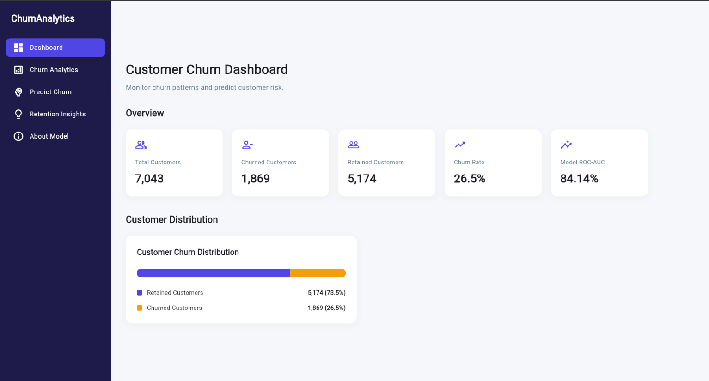

# Customer Churn Prediction & Retention Analytics

An end-to-end Machine Learning application that predicts customer churn using historical telecom customer data and provides customer segmentation analytics through an interactive web dashboard.

Built using **Python, Scikit-learn, FastAPI and Flutter Web**, this project combines predictive machine learning with historical churn analytics.

---

## Project Overview

Customer churn occurs when customers discontinue a company's services. Identifying customers who are likely to leave helps businesses understand customer behaviour and make informed retention decisions.

This project uses the IBM Telco Customer Churn dataset to:

- Explore historical customer churn patterns.
- Perform exploratory data analysis and preprocessing.
- Train and compare multiple machine learning algorithms.
- Predict individual customer churn probability.
- Provide predictions through a REST API.
- Analyze churn across different customer segments.
- Display analytics through an interactive Flutter Web dashboard.

The application separates historical dataset analytics from individual customer predictions.

---

## Application Screenshots

### 1. Dashboard



### 2. Churn Analytics


### 3. Predict Customer Churn


---

## Features

### Machine Learning
- Exploratory Data Analysis.
- Data preprocessing and feature engineering.
- Comparison of four classification algorithms.
- Stratified 5-fold cross-validation.
- Logistic Regression model selection.
- Model evaluation using multiple classification metrics.
- Model serialization using Joblib.
- Reusable prediction module.

### Backend
- FastAPI REST API.
- Pydantic input validation.
- Customer churn prediction endpoint.
- Contract-wise churn analytics endpoint.
- Retention insights endpoint.
- Health check endpoint.
- CORS configuration.

### Frontend
- Interactive Flutter Web dashboard.
- Customer overview KPI cards.
- Customer churn distribution.
- Contract-wise churn analysis.
- Individual customer prediction form.
- Retention insights by customer segment.
- Model performance information.
- Sidebar-based navigation.
- API integration with loading and error handling.

---

## Technology Stack

| Category | Technologies |
|---|---|
| Programming Language | Python |
| Data Analysis | Pandas, NumPy |
| Visualization | Matplotlib, Seaborn |
| Machine Learning | Scikit-learn |
| Model Persistence | Joblib |
| Notebooks | Jupyter Notebook |
| Backend | FastAPI, Uvicorn |
| Validation | Pydantic |
| Frontend | Flutter, Dart |
| API Communication | HTTP, JSON |
| Version Control | Git, GitHub |

---

## Dataset

**Dataset:** IBM Telco Customer Churn

The dataset contains telecommunications customer information, including:

- Customer demographics.
- Account information.
- Internet and phone services.
- Contract details.
- Monthly and total charges.
- Customer tenure.
- Churn status.

### Dataset Information

| Property | Value |
|---|---:|
| Total records | 7,043 |
| Total columns | 21 |
| Input features | 19 |
| Target variable | Churn |
| Missing TotalCharges values | 11 |
| Duplicate records | 0 |

The `customerID` column is excluded from model training because it is an identifier rather than a predictive feature.

### Target Distribution

| Customer Category | Records | Percentage |
|---|---:|---:|
| No Churn | 5,174 | 73.5% |
| Churn | 1,869 | 26.5% |

Target encoding:

- No → 0
- Yes → 1

---

## Machine Learning Workflow

The project follows a structured machine learning workflow.

1. Dataset loading and exploration.
2. Exploratory Data Analysis.
3. Handling missing values.
4. Separating numerical and categorical features.
5. Train-test splitting using stratification.
6. Building preprocessing pipelines.
7. Comparing classification algorithms.
8. Selecting the final model.
9. Evaluating model performance.
10. Saving the trained pipeline using Joblib.

### Data Preprocessing

**Numerical features**

- Median imputation.
- Standard scaling using StandardScaler.

**Categorical features**

- Most-frequent imputation.
- One-hot encoding using OneHotEncoder.

A Scikit-learn `ColumnTransformer` combines both preprocessing pipelines.

The preprocessing and classification stages are integrated into a single Scikit-learn Pipeline to ensure consistent transformations during training and prediction.

### Models Evaluated

Four classification algorithms were compared:

1. Logistic Regression.
2. Decision Tree.
3. Random Forest.
4. Support Vector Machine (SVM).

Model comparison was performed using stratified 5-fold cross-validation.

### Model Comparison Results

| Model | Accuracy | Precision | Recall | F1-Score | ROC-AUC |
|---|---:|---:|---:|---:|---:|
| Logistic Regression | 0.7488 | 0.5174 | 0.8013 | 0.6286 | 0.8460 |
| SVM | 0.7504 | 0.5197 | 0.7799 | 0.6236 | 0.8267 |
| Random Forest | 0.7774 | 0.5712 | 0.6468 | 0.6065 | 0.8237 |
| Decision Tree | 0.7430 | 0.5159 | 0.5037 | 0.5096 | 0.6668 |

### Selected Model: Logistic Regression

Logistic Regression was selected based on its recall, F1-score and ROC-AUC performance.

The model uses class weighting to account for the imbalance between churn and non-churn customers.

### Final Model Evaluation

The selected model was evaluated on a separate test dataset.

| Metric | Score |
|---|---:|
| Accuracy | 73.74% |
| Precision | 50.34% |
| Recall | 78.34% |
| F1-Score | 61.30% |
| ROC-AUC | 84.14% |

**Interpretation:**

- The model identifies a substantial proportion of actual churn customers.
- Recall of 78.34% indicates that the model detects approximately 78% of actual churn cases in the test set.
- ROC-AUC of 84.14% indicates good discrimination between churn and non-churn customers.
- Precision of 50.34% indicates that approximately half of the customers predicted to churn actually churned in the test set.

These results represent the current baseline model performance.

---

## Project Architecture

The application follows a modular architecture separating data science experimentation, production machine learning logic, backend services and frontend presentation.

```text
                    CUSTOMER CHURN
                 PREDICTION & ANALYTICS
                          |
          +---------------+---------------+
          |                               |
     DATA SCIENCE                    APPLICATION
          |                               |
   Jupyter Notebooks                 Flutter Web
          |                               |
   Data Exploration                Analytics Dashboard
          |                               |
   Preprocessing                   REST API Requests
          |                               |
   Model Training                      FastAPI
          |                               |
   Model Evaluation              +--------+--------+
          |                      |        |        |
   Joblib Pipeline           Predict  Analytics  Insights
          |                      |        |        |
          +----------------------+--------+--------+
                                 |
                         JSON Responses
                                 |
                            Flutter UI
```

### Application Flow

**Individual Prediction**

1. User enters customer information through the Flutter interface.
2. Flutter sends customer data to FastAPI.
3. FastAPI validates the incoming request using Pydantic.
4. The saved machine learning pipeline processes the input.
5. The model generates a churn prediction and probability.
6. FastAPI returns the result as JSON.
7. Flutter displays the prediction.

**Historical Analytics**

1. FastAPI reads the historical customer dataset.
2. Pandas groups customers by selected dimensions.
3. Churn counts and churn rates are calculated.
4. The API returns aggregated analytics.
5. Flutter displays the results.

Historical analytics and individual predictions are handled separately.

---

## Application Modules

### 1. Dashboard

Displays an overview of the historical dataset:

- Total customers.
- Churned customers.
- Retained customers.
- Overall churn rate.
- Model ROC-AUC.
- Customer churn distribution.

### 2. Churn Analytics

Provides contract-wise historical churn analysis.

The dashboard displays:

- Contract type.
- Total customers.
- Churned customers.
- Churn percentage.

### 3. Predict Churn

Allows users to enter individual customer information and obtain:

- Churn prediction.
- Estimated churn probability.

The prediction is generated using the saved Scikit-learn pipeline.

### 4. Retention Insights

Analyzes historical churn patterns across three dimensions:

- Contract.
- Internet Service.
- Customer Tenure.

Customers are grouped into segments, and their historical churn rates are calculated.

The displayed risk labels are descriptive categories based on historical segment churn rates, not separate machine learning predictions.

### 5. About Model

Displays:

- Selected algorithm.
- Dataset information.
- Model evaluation metrics.
- Preprocessing methods.
- Machine learning pipeline.
- Technologies used.

---

## Repository Structure

```text
customer-churn-prediction/
│
├── data/
│   ├── raw/
│   │   └── Telco-Customer-Churn.csv
│   └── processed/
│
├── notebooks/
│   ├── 01_eda.ipynb
│   ├── 02_preprocessing.ipynb
│   └── 03_modeling.ipynb
│
├── src/
│   ├── __init__.py
│   ├── data_loader.py
│   ├── evaluate.py
│   ├── predict.py
│   ├── preprocessing.py
│   └── train.py
│
├── models/
│   └── churn_pipeline.joblib
│
├── api/
│   ├── __init__.py
│   ├── app.py
│   ├── analytics.py
│   └── insights.py
│
├── frontend/
│   ├── lib/
│   │   ├── main.dart
│   │   ├── app_config.dart
│   │   ├── analytics_service.dart
│   │   ├── prediction_service.dart
│   │   ├── prediction_screen.dart
│   │   ├── insights_service.dart
│   │   ├── retention_screen.dart
│   │   └── about_model_screen.dart
│   ├── web/
│   │   ├── index.html
│   │   └── _redirects
│   ├── test/
│   │   └── widget_test.dart
│   ├── pubspec.yaml
│   └── README.md
│
├── screenshots/
│   ├── dashboard.png
│   ├── churn analytics.png
│   └── Predict customer churn.png
│
├── tests/
│   ├── __init__.py
│   └── test_prediction.py
│
├── .gitignore
├── requirements.txt
├── render.yaml
├── README.md
└── LICENSE
```

---

## Backend API Documentation

The backend is developed using FastAPI.

### Available Endpoints

| Method | Endpoint | Description |
|---|---|---|
| GET | `/` | API welcome message |
| GET | `/health` | API health status |
| POST | `/predict` | Predict individual customer churn |
| GET | `/analytics/contracts` | Contract-wise churn analytics |
| GET | `/analytics/retention-insights` | Historical retention insights |

### Prediction Request

The `/predict` endpoint accepts customer information in JSON format.

Example:

```json
{
  "gender": "Female",
  "SeniorCitizen": 0,
  "Partner": "Yes",
  "Dependents": "No",
  "tenure": 12,
  "PhoneService": "Yes",
  "MultipleLines": "No",
  "InternetService": "DSL",
  "OnlineSecurity": "No",
  "OnlineBackup": "Yes",
  "DeviceProtection": "No",
  "TechSupport": "No",
  "StreamingTV": "No",
  "StreamingMovies": "No",
  "Contract": "Month-to-month",
  "PaperlessBilling": "Yes",
  "PaymentMethod": "Electronic check",
  "MonthlyCharges": 65.5,
  "TotalCharges": 786.0
}
```

`TotalCharges` can also be omitted or provided as `null`.

### Prediction Response

```json
{
  "prediction": "Churn",
  "churn_probability": 0.5462
}
```

The probability represents the model's estimated likelihood of customer churn.

### API Documentation

FastAPI automatically generates interactive API documentation.

After starting the backend, access:

- Swagger UI: `http://127.0.0.1:8000/docs`
- ReDoc: `http://127.0.0.1:8000/redoc`

---

## Installation and Setup

### Prerequisites

Install the following:

- Python 3.10 or compatible version.
- Flutter SDK.
- Dart SDK (included with Flutter).
- Google Chrome.
- Git.

### 1. Clone the Repository

```bash
git clone https://github.com/Pranay-Pandurang-Patil/customer-churn-prediction.git

cd customer-churn-prediction
```

### 2. Set Up Python Environment

Create a virtual environment:

```bash
python -m venv .venv
```

Activate it on Windows:

```cmd
.venv\Scripts\activate
```

Install dependencies:

```bash
pip install -r requirements.txt
```

### 3. Run the FastAPI Backend

From the project root:

```bash
python -m uvicorn api.app:app --reload
```

The backend will run at:

```text
http://127.0.0.1:8000
```

### 4. Run the Flutter Web Frontend

Open another terminal:

```bash
cd frontend
```

Install Flutter dependencies:

```bash
flutter pub get
```

Run the application:

```bash
flutter run -d chrome --dart-define=API_BASE_URL=http://127.0.0.1:8000
```

The frontend communicates with the FastAPI backend through the configured API base URL.

---

## Testing

### Flutter Analysis

From the `frontend` directory:

```bash
flutter analyze
```

### Flutter Widget Tests

```bash
flutter test
```

### Python Prediction Test

From the repository root:

```bash
python -m tests.test_prediction
```

### API Testing

Use the interactive Swagger documentation:

```text
http://127.0.0.1:8000/docs
```

The frontend and backend should both be running for complete application integration testing.

---

## Deployment Status

The application is currently configured for local development.

Deployment preparation includes:

- Render configuration through `render.yaml`.
- Netlify redirect configuration.
- Environment-based frontend API URL.
- Backend CORS configuration using `FRONTEND_ORIGIN`.

**Production deployment is not yet completed.**

Planned deployment platforms:

- Backend: Render.
- Frontend: Netlify.

---

## Limitations

- The model uses historical telecom customer data.
- Predictions are estimates and do not guarantee future customer behaviour.
- Model performance represents a baseline and can be improved.
- Retention insights describe historical customer segments; they do not constitute personalized retention recommendations.
- The application is not yet deployed to production.

---

## Future Enhancements

- Deploy the backend and frontend.
- Add more advanced customer segmentation.
- Improve model performance through further experimentation.
- Add explainable AI techniques for prediction interpretation.
- Develop actionable retention recommendations.
- Improve dashboard visualizations.
- Add more comprehensive automated integration tests.

---

## Author

**Pranay Pandurang Patil**

Computer Science and Engineering Student  
KLS Gogte Institute of Technology, Belgaum.

GitHub: https://github.com/Pranay-Pandurang-Patil

Project Repository:  
https://github.com/Pranay-Pandurang-Patil/customer-churn-prediction

---

## License

This project is licensed under the MIT License. See the [LICENSE](LICENSE) file for details.